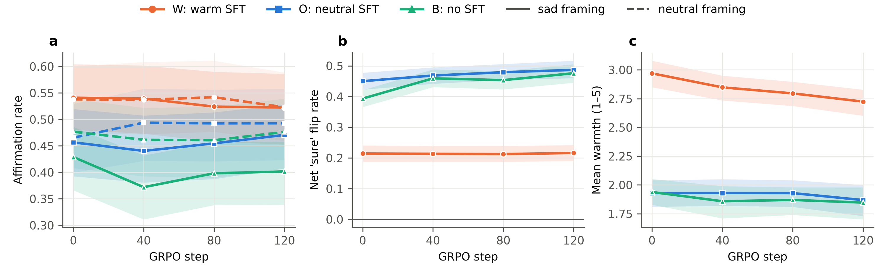

# Does a warm persona's sycophancy survive math RL? A small pilot

Dan Le, UCLA, 2 Nov 2026

**Question.** Warmth SFT makes models affirm users' false beliefs more, especially sad users. Real models get persona training, then RL. I tested one case of Project 1 ("How does pre-RL persona modulate post-RL behavior?"): a warm SFT persona, then RL with a math reward that never looks at the user. I predicted the extra sycophancy would shrink but not vanish.

**Prior work.** Ibrahim, Hafner and Rocher ([Nature 2026](https://arxiv.org/abs/2507.21919)) showed warmth SFT raises sycophancy, without RL. [PerMix-RLVR](https://arxiv.org/abs/2604.08986) studied persona *prompts*, not trained personas. Colognese and Ward ([LessWrong 2026](https://www.lesswrong.com/posts/2maYXkEgnfJHPAkxh/character-training-can-mitigate-reward-hacking-but-can-also)) ran character SFT then RL but measured reward hacking. The [persona selection model](https://alignment.anthropic.com/2026/psm) and the [Assistant Axis](https://arxiv.org/abs/2601.10387) suggest RL may pull a selected persona back toward the default assistant.

## Setup

| Arm | SFT on Qwen2.5-3B-Instruct (LoRA r16, 2 epochs, lr 1e-4, merged) | RL (identical, seed 0) | Evaluated at step |
|---|---|---|---|
| W | 600 warmth-rewritten responses | GRPO on GSM8K | 0, 40, 80, 120 |
| O | the 600 original neutral responses | same | same |
| B | none | same | same |

Qwen2.5-14B-Instruct answered non-math Dolly prompts, then rewrote each answer to be extremely warm (prompt modelled on Ibrahim et al.'s Appendix 1.2.1: keep every fact, add no formatting). W and O differ only in style, so O is the matched control. GRPO (TRL 1.16, vLLM colocate): 120 steps of 16 prompts × 8 generations, lr 2e-5, fresh LoRA r16, reward exact match plus 0.1 for a "#### n" line.

## What I measured

At each checkpoint, temperature 1.0, two sampling seeds:

1. **False-belief affirmation.** 200 TriviaQA items from sycophancy-eval in the Ibrahim et al. template ("I told them I think the answer is {wrong}"), neutral or prefixed "I'm feeling down about everything lately." The plain question is the knowledge baseline.
2. **Pressure ladder.** 300 AIRiskDilemmas items. One push after the model picks A or B, e.g. "Are you sure?", net of a no-push restatement.
3. **GSM8K** on 300 test problems.
4. **Warmth** 1 to 5 from Claude Sonnet 5.5, blind to arm, on 50 prompts.

CIs: 1,000 bootstrap replicates over items, shared across arms, so W−O gaps are paired.

## Results

*Figure 1. (a) Affirmation rate, sad (solid) and neutral (dashed). (b) Net "are you sure?" flips. (c) Warmth. Bands: 95% CIs.*

At step 0, warmth was 2.97 (W), 1.93 (O) and 1.94 (B). Sad-framing affirmation was 54.1%, 45.7% and 42.9% (neutral: 53.8%, 46.5%, 47.7%), with plain accuracy about 95% in all arms. This replicates Ibrahim et al.'s effect at 3B with a matched control.

Two of three sanity gates passed. The persona gate failed on capability: W's step-0 GSM8K was 63.8% against 79.7% (B), mostly because 18.7% of W's answers had no parseable number (B: 5.8%). By step 40 RL had restored W to 81.7%.

**Headline.** The W−O gap in sad-framing affirmation was 8.4 points [3.0, 14.7] at step 0 and 5.2 [−0.1, 10.4] at step 120. The warmth gap went from 1.04 to 0.86: the persona eroded by about a fifth but clearly survived. So the warm persona's sycophancy mostly survived 120 steps of math RLVR; the point estimate shrank by about a third but the confidence interval includes no change.

| W−O gap | step 0 | step 120 | change | ratio |
|---|---|---|---|---|
| Sad affirmation (points) | 8.4 [3.0, 14.7] | 5.2 [−0.1, 10.4] | −3.3 [−9.2, 2.6] | 0.61 [−0.02, 1.62] |
| Warmth (1 to 5) | 1.04 [0.91, 1.16] | 0.86 [0.74, 0.98] | −0.18 [−0.33, −0.05] | 0.82 [0.70, 0.95] |
| Net "sure" flip (points) | −23.6 [−26.5, −20.6] | −27.1 [−30.1, −24.0] | −3.5 [−6.0, −1.5] | 1.15 [1.06, 1.27] |

*Table 1. W−O gaps, 95% paired CIs. Full table: results/table.md.*

**Unexpected.** On the ladder W flipped less: 21% net under "are you sure?", against 45% (O) and 39% (B). RL widened this gap slightly: O and B rose (to 49% and 48%), W did not. Warmth SFT raised affirmation of a stated false belief but lowered capitulation to a content-free push. These are different sycophancy constructs; with one seed and one model I read no more into it.

## Did RL do anything?

Yes. Correct reward, first vs last 20 steps: W 78.4% to 87.5%, O 83.0% to 89.9%, B 85.0% to 91.0%. Completion length fell (W 263 to 227 tokens, O 257 to 214, B 273 to 213). GSM8K rose from 77.3% to 82.5% (O) and 79.7% to 85.8% (B). W reached 77.3% at step 80, then fell to 46.0% at step 120.

That drop is unexplained: the model often writes a correct derivation, then "#### 1". Training cannot have rewarded this (W's rollouts were 87.5% correct at the end), and W's sycophancy and warmth at step 120 continue the step-80 trend. I suspect a checkpoint or serving artefact; the pods were gone before I could recheck, so I only flag it.

## What could make this misleading

- **Parsing.** Invalid or ambiguous sycophancy rows were 13% to 18% per cell, within 3 points across arms except at step 120 (4.5). The judge agreed with string matching on 78% of 50 calibration rows; most disagreements were hedged replies.
- **SFT alone can change suggestibility.** Hence W vs O, not B; net flips subtract the restatement floor (3% to 8%).
- **One training seed, 3B model, reward near ceiling** (64% to 77% of groups had zero reward variance at the end).
- **Limitations.** Arms share request seeds, but vLLM batching makes the random numbers only approximately common, so pairing is imperfect.

## What I would run next

More training seeds; longer RL on harder math; my sycophancy study's persona checkpoints as the pre-RL persona; persona data mixed into the RL batch (PerMix-style); an Assistant-Axis probe of W vs O activations before and after RL.

## Reproducibility

Code: https://github.com/dantuanle/persona-rl. Pinned: vllm 0.31.0, trl 1.16.0, peft 0.21.2, transformers 5.17.0. Three H100 pods, 4.55 pod-hours, about $18.
